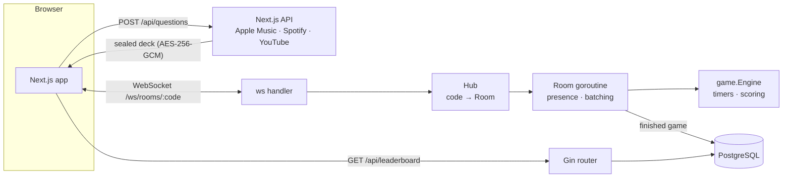

# songquiz-server

Real-time game server for a Thai song quiz party game, written in Go.
Players join a room from their phones, hear a 30-second preview, and race to pick the song title.
This server runs the whole game: rooms, presence, timers, scoring, and the leaderboard.

- **Server-authoritative:** the answer key never leaves the server. Clients get a state that only ever holds the current question's titles. Artists and the correct answer show up only at the reveal.
- **One goroutine per room:** joins, leaves, answers and timer ticks go through the room's loop, so the game engine needs no locks.
- **Survives drop-outs:** a player who refreshes within 3 s comes back with their score, no "left the room" flicker. If the host leaves, host controls move to the next player and the game keeps going.
- **Tested without sleeping:** the engine runs on an injectable clock, so a whole game plays out in microseconds in unit tests. Integration tests drive real WebSockets through `httptest`.

## Architecture



The web app builds the questions (music APIs and the host's Spotify login live there), seals them with a shared secret, and the host's browser forwards the sealed deck. Only this server can open it, so no browser ever sees an answer. That includes the host's.

| Package | Job |
|---|---|
| `internal/game` | Pure rules: types, scoring, the engine (lobby → loading → question → reveal → standings → final) |
| `internal/clock` | Real and fake clocks |
| `internal/room` | Room loop, presence grace, host hand-over, state batching, hub with limits |
| `internal/ws` | WebSocket ↔ room adapter with per-client write buffers (slow clients are dropped, never block a room) |
| `internal/deck` | Opens decks sealed by the web app |
| `internal/store` | Postgres (pgx) or in-memory: saved games and the leaderboard |
| `internal/httpapi` | Gin routes: `/healthz`, `/api/leaderboard`, `/ws/rooms/:code` |

## Protocol

Connect: `GET /ws/rooms/{CODE}?pid=<uuid>&name=<name>&color=%23rrggbb[&create=1]`.
Every frame is `{"type": "...", "data": ...}`.

| Client → server | Data | Who |
|---|---|---|
| `settings` | `{source, rounds, roundSeconds, listenSeconds}` | host |
| `loading` | – | host (songs are being fetched) |
| `start` | `{deck, warnings}` | host |
| `loadFailed` | `{message}` | host |
| `answer` | `{questionId, choice, ms}` | anyone |
| `next` / `reveal` / `lobby` | – | host |
| `ping` | – | anyone, every 20 s |

The server sends `state` (the full game state, versioned; urgent changes are sent right away, answer counts are batched every 300 ms), `error` `{message}` and `pong`.
Close codes: `4404` room not found, `4409` replaced by a newer tab, `4429` full, `4408` too slow.

Limits: 500 rooms, 30 players per room, 512 KB per frame. A room is deleted 2 minutes after it empties.

## Leaderboard

`GET /api/leaderboard?period=week|all&limit=1..50` returns the best single-game scores.
Only games with 2+ players and 5+ questions count. The week starts Monday 00:00 Bangkok time. Responses are cached for 30 s.

## Run

```bash
docker compose up --build          # server + Postgres on :8080
go run ./cmd/server                 # or without Docker (in-memory leaderboard)
```

| Env | Default | |
|---|---|---|
| `PORT` | `8080` | |
| `DECK_SECRET` | dev value | Must match the web app. Required (32+ chars) when `APP_ENV=production` |
| `DATABASE_URL` | empty → in memory | Works with Supabase's pooler (simple protocol) |
| `ALLOWED_ORIGINS` | `localhost:3000,…` | Comma-separated host patterns for WebSocket and CORS |

## Test

```bash
go test ./...                                    # unit + WebSocket integration
TEST_DATABASE_URL=postgres://... go test ./...   # also runs the Postgres store suite
```

CI runs `go vet`, staticcheck, `go test -race` against a real Postgres, a Docker build, and gitleaks.

## Deploy

`render.yaml` deploys the Docker image to Render (free plan). Set `DECK_SECRET`, `DATABASE_URL` and `ALLOWED_ORIGINS` in the dashboard.

## License

MIT
